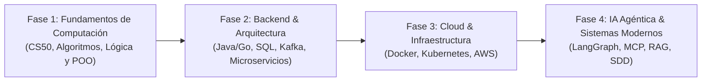

# 🚀 Ruta de Especialización en Ingeniería de Software, Backend & Inteligencia Artificial

[](https://github.com/Trujillo7915)
[](https://github.com/Trujillo7915)
[](LICENSE)

Repositorio centralizado de aprendizaje continuo, bitácora de estudio técnico, proyectos prácticos y preparación rigurosa para roles de **Ingeniero de Software Backend & Desarrollador de Sistemas de Inteligencia Artificial**.

---

## 📌 Tabla de Contenidos

- [🎯 Propósito y Visión](#-propósito-y-visión)
- [🗺️ Hoja de Ruta de Aprendizaje (Roadmap por Fases)](#️-hoja-de-ruta-de-aprendizaje-roadmap-por-fases)
- [📂 Estructura del Repositorio](#-estructura-del-repositorio)
- [📊 Matriz de Seguimiento y Certificaciones](#-matriz-de-seguimiento-y-certificaciones)
- [📐 Estándares de Código y Documentación](#-estándares-de-código-y-documentación)
- [👤 Autor](#-autor)

---

## 🎯 Propósito y Visión

Este repositorio documenta mi evolución técnica estructurada desde los fundamentos de la computación hasta arquitecturas empresariales modernas y sistemas agénticos con IA. Cada módulo contiene:

1. **Notas conceptuales profundas:** Resúmenes técnicos, modelos mentales y diagramas explicativos.
2. **Ejercicios prácticos:** Resolución de problemas algorítmicos, pruebas unitarias y katas de código.
3. **Proyectos integradores:** Implementaciones de software reales siguiendo principios de *Clean Code*, patrones de diseño y estándares de la industria.

---

## 🗺️ Hoja de Ruta de Aprendizaje (Roadmap por Fases)



### 🔹 Fase 1: Fundamentos de Ciencias de la Computación y Lógica Base
- **Harvard CS50x:** Representación binaria, memoria, punteros, complejidad algorítmica ($O(n)$, $O(\log n)$), estructuras de datos fundamentales.
- **Fundamentos de Programación Web y Scripting:** JavaScript moderno, manipulación del DOM, estándares HTML5/CSS3.
- **Programación Orientada a Objetos (POO):** Abstracción, encapsulamiento, herencia y polimorfismo.

### 🔹 Fase 2: Backend de Alto Rendimiento, Datos y Arquitectura
- **Lenguaje Tipado Empresarial:** Java moderno (SE 17/21) con Spring Boot o Go (Golang).
- **Persistencia y Modelado de Datos:** PostgreSQL, transacciones ACID, optimización de índices, bases de datos NoSQL (MongoDB).
- **Arquitectura de Software:** Principios SOLID, Clean Architecture, APIs RESTful y sistemas orientados a eventos con **Apache Kafka**.

### 🔹 Fase 3: Cloud, Contenedores y DevOps
- **Contenedores:** Empaquetado multicapa con Docker y orquestación local mediante Docker Compose.
- **Despliegue y Orquestación:** Fundamentos de Kubernetes (Pods, Services, Deployments).
- **Computación en la Nube:** Amazon Web Services (AWS) - Redes seguras (VPC), instancias de cómputo, almacenamiento y bases de datos gestionadas.

### 🔹 Fase 4: Inteligencia Artificial Moderna, Agentes y MCP
- **Flujos Agénticos:** Orquestación de grafos de decisión con **LangGraph** y ejecución autónoma.
- **Model Context Protocol (MCP):** Conexión segura entre modelos fundacionales y herramientas del entorno.
- **RAG & Guardrails:** Búsqueda semántica con bases de datos vectoriales y control de seguridad en respuestas.
- **Spec-Driven Development (SDD):** Desarrollo guiado por especificaciones formales asistido por agentes.

---

## 📂 Estructura del Repositorio

```text
estudio-preparacion/
├── README.md                                  # Documentación principal y roadmap
├── .gitignore                                 # Exclusiones de Git
│
├── fase 1/                                    # Fundamentos y Lógica
│   ├── CSX50 - Harvard/                      # Bitácora, notas y problem sets de CS50
│   │   └── documentacion.txt
│   │
│   ├── Fundamentos de programacion con JS - HTML5/
│   │   └── Documentación.txt                  # Fundamentos web y lógica en JavaScript
│   │
│   └── java-backend-core/                     # Ejercicios de Java puro, colecciones y POO
│
├── fase 2/                                    # (En planificación) Backend, BD y Kafka
├── fase 3/                                    # (En planificación) Docker, Kubernetes y AWS
└── fase 4/                                    # (En planificación) Agentes IA, LangGraph y MCP
```

---

## 📊 Matriz de Seguimiento y Certificaciones

| Hito / Módulo | Plataforma / Entidad | Estado | Credencial / Proyecto |
|---|---|:---:|---|
| **CS50x: Intro to Computer Science** | Harvard University (edX) | 🔄 En curso | *Problem Sets & Certificado oficial* |
| **Fundamentos Web (JS & HTML5)** | Formación Profesional / Autodidacta | 🔄 En curso | *Módulos y prácticas base* |
| **Java Basic Skills** | HackerRank | ⏳ Pendiente | *Insignia / Certificado de habilidad* |
| **Postman API Student Expert** | Postman Academy | ⏳ Pendiente | *Insignia oficial Credly* |
| **Relational Database & SQL** | freeCodeCamp / PostgreSQL | ⏳ Pendiente | *Certificación de bases de datos* |
| **AWS Cloud Essentials** | AWS Skill Builder | ⏳ Pendiente | *Badge oficial de Amazon* |
| **AI Agents & MCP Fundamentals** | DeepLearning.AI / Hugging Face | ⏳ Pendiente | *Proyectos de agentes autónomos* |

*Convenciones:*  
✅ Completado | 🔄 En curso | ⏳ Pendiente

---

## 📐 Estándares de Código y Documentación

Para garantizar calidad profesional en cada entrega, se siguen las siguientes políticas:

- **Commits Convencionales (Conventional Commits):**
  - `feat:` Nuevos módulos, notas o proyectos funcionales.
  - `fix:` Corrección de errores en código o documentación.
  - `docs:` Actualización de notas de estudio, bitácoras o diagramas.
  - `refactor:` Optimización de código sin alterar su comportamiento.
- **Clean Code:** Nombres de variables autodescriptivos, funciones atómicas y sin mutabilidad accidental.
- **Control de Versiones Limpio:** Cero archivos compilados, temporales o credenciales en el historial.

---

## 👤 Autor

**Desarrollador:** [@Trujillo7915](https://github.com/Trujillo7915)  
**Objetivo:** Construir bases de ingeniería de software sólidas, reproducibles y orientadas a la excelencia técnica.

---
*“El código limpio siempre parece que fue escrito por alguien a quien le importaba.” — Robert C. Martin*
